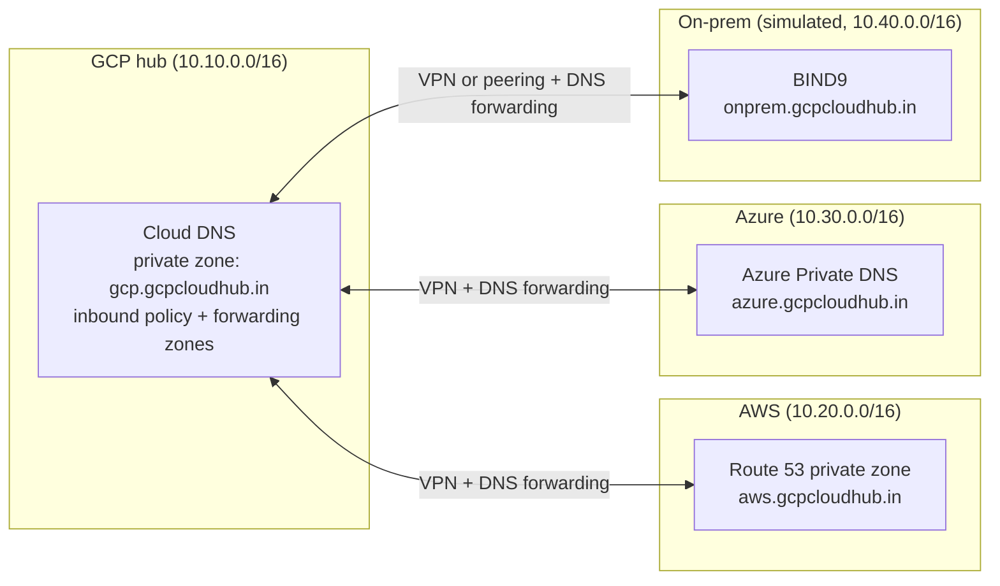

# gcp-multicloud-dns-hub

Unified DNS across GCP, AWS, Azure and on-prem using Cloud DNS as the central hub. Terraform, GitHub Actions, split-horizon DNS, hands-on lab.

> **Status:** work in progress. Phase 1 and the GCP hub (Phase 2) are scaffolded. AWS, Azure and on-prem are added phase by phase.

## The problem

Workloads run in GCP, AWS, Azure and on-prem. Each has its own DNS system, yet a service in one place must be able to find a service in another by name.

## The design

One hub, with each environment authoritative for its own subdomain. Cloud DNS in GCP is the hub: it forwards queries out to the other environments and exposes inbound resolver IPs so they can query GCP.



| Environment | Network | Private zone | DNS server |
|---|---|---|---|
| GCP (hub) | 10.10.0.0/16 | `gcp.gcpcloudhub.in` | Cloud DNS |
| AWS | 10.20.0.0/16 | `aws.gcpcloudhub.in` | Route 53 private zone (+ BIND VM or Resolver endpoints) |
| Azure | 10.30.0.0/16 | `azure.gcpcloudhub.in` | Azure Private DNS (+ CoreDNS VM or Private Resolver) |
| On-prem (simulated) | 10.40.0.0/16 | `onprem.gcpcloudhub.in` | BIND9 VM |

**Rule:** private zones are created at the subdomain level, never at the apex `gcpcloudhub.in`. An apex private zone would shadow the public domain inside the VPCs.

## Cloud DNS building blocks used

| Capability | Purpose |
|---|---|
| Private managed zone | Internal records for GCP workloads |
| Forwarding zone (outbound) | Send queries for `aws.`, `azure.` and `onprem.` to their DNS servers |
| Inbound server policy | Gives other environments a resolver IP inside the hub VPC to query GCP names |
| DNS peering | Lets spoke VPCs resolve through the hub (hub-and-spoke) |
| Public zone | Split-horizon demo for the real domain |

## Repository layout

```
.
├── README.md
├── docs/
├── scripts/
│   └── test-dns.sh              # resolve names and print PASS/FAIL
└── terraform/
    ├── modules/
    │   └── gcp-hub/             # VPC, private zone, inbound policy, forwarding zones, test VM
    └── envs/
        └── lab/                 # root module that wires everything together
```

More modules are added per phase: `aws-spoke`, `azure-spoke`, `onprem-sim`, `vpn`.

## Roadmap

| Phase | What | Status |
|---|---|---|
| 1 | Repo and Terraform skeleton | Done |
| 2 | GCP hub: VPC, private zone, inbound policy, forwarding zones | Scaffolded |
| 3 | AWS spoke | Planned |
| 4 | Azure spoke | Planned |
| 5 | On-prem simulation (BIND9) | Planned |
| 6 | VPN connectivity | Planned |
| 7 | 4x4 resolution test matrix and split-horizon test | Planned |
| 8 | Failure testing (VPN down) | Planned |
| 9 | Teardown | Planned |

## Quick start (GCP hub only)

Prerequisites: Terraform 1.6 or newer, the `gcloud` CLI, and a GCP project with billing enabled.

```bash
# 1. Authenticate
gcloud auth login
gcloud auth application-default login
gcloud config set project <PROJECT_ID>

# 2. Create the remote state bucket (one time)
gcloud storage buckets create gs://<PROJECT_ID>-tfstate --location=asia-south1 --uniform-bucket-level-access
gcloud storage buckets update gs://<PROJECT_ID>-tfstate --versioning

# 3. Configure Terraform
cd terraform/envs/lab
cp backend.tf.example backend.tf            # edit the bucket name
cp terraform.tfvars.example terraform.tfvars # edit project_id

# 4. Deploy
terraform init
terraform plan
terraform apply
```

After the apply, find the inbound forwarder IPs. These are what AWS, Azure and on-prem forward `gcp.gcpcloudhub.in` queries to:

```bash
gcloud compute addresses list --filter='purpose=DNS_RESOLVER' --format='value(address,subnetwork)'
```

Test from the VM inside the hub:

```bash
gcloud compute ssh dns-test-gcp --zone=asia-south1-a --tunnel-through-iap
# on the VM:
dig +short app1.gcp.gcpcloudhub.in
```

## Public zone and the real domain

The public zone for `gcpcloudhub.in` is optional in Terraform (`create_public_zone`). If a public zone already exists in the project, leave it `false`. If you create one, copy the `public_zone_name_servers` output to your domain registrar. Never put private IPs in the public zone.

## Cost warning

These resources bill by the hour even when idle: VPN gateways and tunnels, Route 53 Resolver endpoints, Azure DNS Private Resolver, NAT gateways, and public IPs. Run `terraform destroy` after each session and check every console for leftovers.

## Security

- No keys in the repo. State lives in a GCS bucket. `*.tfvars`, `backend.tf` and credential files are git-ignored.
- CI authenticates with OIDC and Workload Identity Federation (added in a later phase).
- Delete any local AWS access keys when the lab ends.

## License

MIT (add a `LICENSE` file if you want to publish this under that license).
